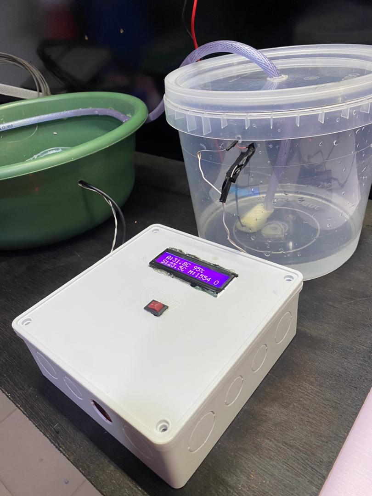
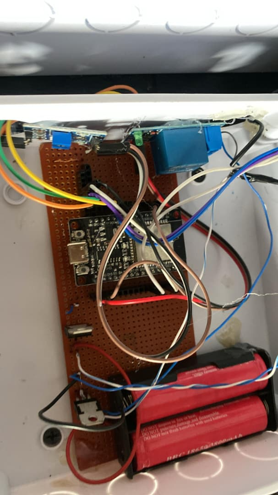
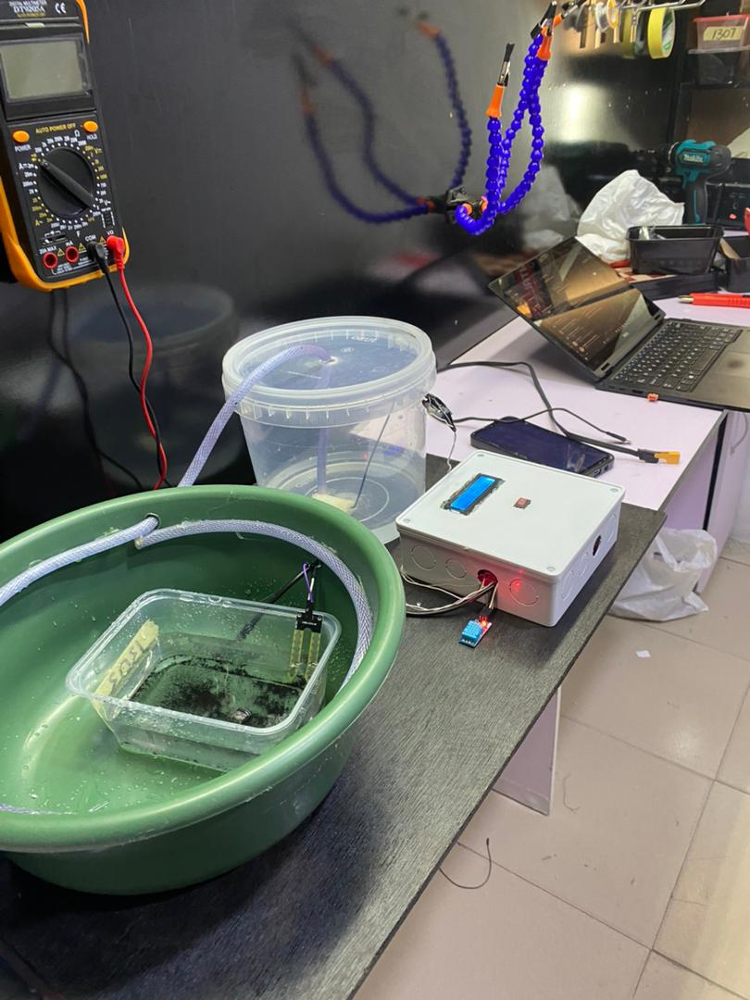
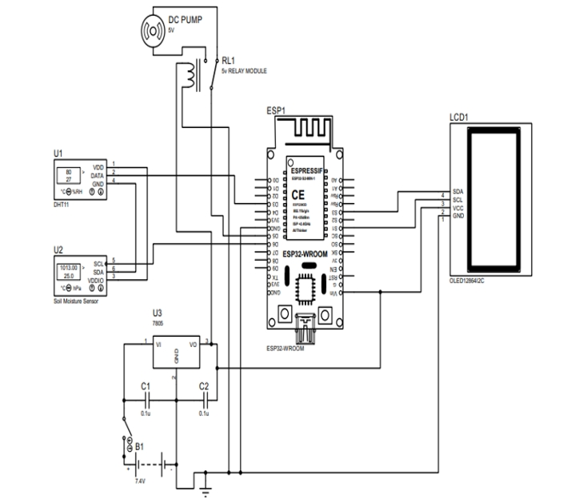
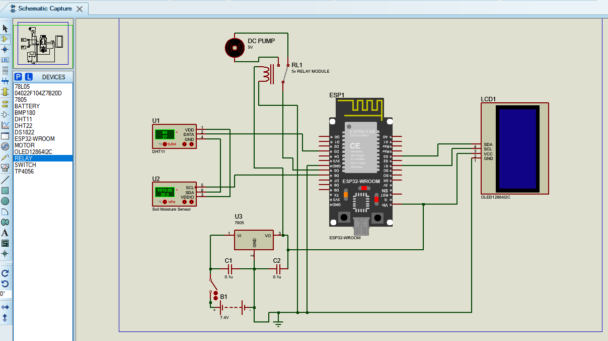

# 🌱 IoT-Based Agricultural Monitoring System

> A low-cost, ESP32-powered smart irrigation and farm-monitoring system designed for
> small-scale and subsistence farmers in Nigeria.


-orange)

**B.Eng. Final-Year Project** — Department of Electrical/Electronic Engineering,
College of Engineering and Technology, Federal University of Petroleum Resources, Effurun, Delta State, Nigeria (2025).

| | |
|---|---|
| **Authors** | Onayifeke Edison Oghenerunor (COT/6392/2019) · Otome Fortune (COT/6397/2019) |
| **Supervisor** | Engr. Mrs. Rebecca O. Ohwo |
| **Plagiarism check** | 12% similarity (Plagia CheckerX) |

---

## 📌 Abstract

This project presents the design and implementation of an Internet of Things (IoT)-based
agricultural monitoring system aimed at addressing the inefficiencies of traditional subsistence
farming practices in Nigeria. The system integrates an ESP32-WROOM microcontroller with a
network of sensors including a DHT11 for atmospheric temperature and humidity, a DS18B20
for soil temperature, and a resistive soil moisture sensor that operates on the principle of inverse
electrical resistance, where lower raw ADC values indicate wetter soil and higher values indicate
drier soil.
Data is captured through a continuous 2-second sensing loop, with the ESP32 reading all sensors
in real-time. The captured data drives an automated irrigation control
logic based on dual-threshold hysteresis: the pump activates when soil moisture exceeds the
DRY_THRESHOLD (2200 raw ADC value, indicating high resistance/dry soil) and deactivates
when moisture falls below the WET_THRESHOLD (1600 raw ADC value, indicating low
resistance/wet soil). A 20-second safety timeout prevents overwatering in case of sensor failure.
All sensor readings and pump states are displayed locally on a 16×2 I2C LCD and transmitted
via Wi-Fi every minute to a Google Apps Script API, which logs the data as timestamped
entries in a Google Sheets database.
The system features a custom-built web application accessible from any internet-connected
device, providing real-time data visualization, a prepared manual pump-command interface, and PDF export
functionality for farm record-keeping. By combining low-cost hardware, free cloud
infrastructure, and intelligent control logic, this project delivers an affordable, scalable, and userfriendly decision support tool that transforms raw environmental data into actionable agricultural
intelligence for small-scale farmers.

---

## ❓ Why this project?

Roughly **80% of Nigeria's farmers are smallholders** using manual monitoring and
erratic watering schedules. The consequences:

- 💧 Significant agricultural **water waste** from over/under-watering
- 👷 **Labour waste** from constant physical farm visits
- 🌾 Lower yields and reduced resilience to erratic weather
- 📉 Existing "smart farming" solutions are too expensive (Raspberry Pi, AI/ML,
  LoRaWAN) or fragmented across SMS, mobile apps, and local PCs

This project deliberately fills the gap identified in a review of **21 scholarly works
(2015–2023)**: a system that is **simultaneously low-cost, user-friendly, and remotely
accessible from any device** — no app install, no paid IoT platform, no on-site PC.

---

## 🎯 Project Overview

FarmSense combines low-cost sensing, local control, and free cloud infrastructure into one
field-monitoring system. The ESP32 reads air temperature and humidity, soil temperature,
and soil-moisture resistance every 2 seconds. A relay-controlled DC pump is switched by
hysteresis and a maximum run-time safety limit, while an I²C LCD provides local status.

Sensor readings are sent to Google Apps Script and stored in Google Sheets approximately
every minute. A plain HTML, CSS, and JavaScript dashboard retrieves the records, displays
live cards and time-series charts, provides a data table, and exports a PDF report.

### Problem Statement

Smallholder farmers often monitor crops manually and rely on irregular watering schedules.
This can waste water, increase labour, and make it difficult to detect poor irrigation or
environmental changes promptly. Commercial monitoring systems may require paid platforms,
specialised devices, or infrastructure that is impractical for low-budget farms.

### Objectives

1. Develop a low-cost sensor network using an ESP32 for real-time environmental monitoring.
2. Automate irrigation using soil-moisture hysteresis and a pump runtime safety limit.
3. Store sensor readings in a timestamped, remotely accessible Google Sheets database.
4. Provide a responsive web dashboard for data visualisation, records, and reporting.

---

## ✨ Features

| Feature | Description |
|---|---|
| 🔄 Real-time sensing | Air temp/humidity (DHT11), soil temp (DS18B20), soil moisture — every 2 s |
| 💧 Automated irrigation | Hysteresis control (`ON > 2200`, `OFF < 1600`) — no pump chattering |
| 🛡️ Safety timeout | Pump forcibly shut off after 20 s of continuous run |
| 📟 Local display | 16×2 I²C LCD with live readings and pump status |
| ☁️ Free cloud logging | Google Apps Script API → Google Sheets timestamped records |
| 🌐 Web dashboard | Any-device HTML/CSS/JS dashboard with charts + PDF export |
| 🕹️ Remote control interface | Web command queue for a manual pump override |
| 🔋 Battery powered | 7.4 V Li-ion pack with LM7805 regulation — field-portable |

---

## 🏗️ System Architecture

```
┌─────────────┐   ┌──────────────┐   ┌──────────────────────┐
│  DHT11      │   │              │   │  Google Apps Script  │
│  DS18B20    ├──►│   ESP32      ├──►│  + Google Sheets     │
│  Soil (AO)  │   │  -WROOM      │   │  (free cloud DB)     │
└─────────────┘   │  (2 s loop)  │   └──────────┬───────────┘
                  │              │              │
┌─────────────┐   │              │   ┌──────────▼───────────┐
│  16×2 LCD   │◄──┤              │   │  Web dashboard        │
│  (I²C)      │   │              │   │  charts · override ·  │
└─────────────┘   └──────┬───────┘   │  PDF export           │
                         │           └──────────────────────┘
                  ┌──────▼───────┐
                  │ Relay (D26)  │
                  │ 5 V DC Pump  │
                  └──────────────┘
```

**Operational flow** (full block diagrams in thesis, Ch. 3):

1. **Init** → sensors, LCD, relay-OFF for safety, Wi-Fi connect
2. **Loop (every 2 s)** → read all sensors → run pump hysteresis logic → safety-timeout check → update LCD
3. **Cloud timer (every minute)** → JSON payload via HTTPS POST to Apps Script → Google Sheets row
4. **Web app** → fetches the sheet data → renders graphs and current state; command queue support is prepared

---

## 🔩 Hardware

### Bill of Engineering Measurement/Evaluation (BEME)

| # | Component | Qty | Unit (₦) | Amount (₦) |
|---|---|---|---|---|
| 1 | ESP32-WROOM dev board | 1 | 15,000 | 15,000 |
| 2 | DHT11 sensor | 1 | 3,500 | 3,500 |
| 3 | Resistive soil moisture sensor | 1 | 3,000 | 3,000 |
| 4 | 16×2 I²C LCD | 1 | 3,000 | 3,000 |
| 5 | Relay module | 2 | 3,000 | 6,000 |
| 6 | 5 V DC pump | 1 | 3,000 | 3,000 |
| 7 | Resistors & capacitors | — | 5,000 | 5,000 |
| 8 | Li-ion batteries (4.2 V) | 3 | 1,700 | 5,100 |
| 9 | Jumper wires | — | 5,000 | 5,000 |
| 10 | Ply board | 1 | 5,000 | 5,000 |
| 11 | Pipes | 1 | 3,000 | 3,000 |
| 12 | Bucket | 1 | 2,500 | 2,500 |
| 13 | Bowl | 1 | 2,000 | 2,000 |
| 14 | LED (power indicator) | 1 | 200 | 200 |
| 15 | Breadboard | 1 | 5,000 | 5,000 |
| 16 | Veroboard | 2 | 5,000 | 10,000 |
| 17 | Soldering iron | 1 | 5,000 | 5,000 |
| 18 | Soldering lead | 3 | 5,500 | 16,500 |
| 19 | Enclosure box | 1 | 5,000 | 5,000 |
| 20 | Buzzer | 1 | 1,500 | 1,500 |
| 21 | Power switch | 1 | 500 | 500 |
| 22 | LM7805 regulator | 1 | 3,500 | 3,500 |
| 23 | Logistics | — | 10,000 | 10,000 |
| 24 | Miscellaneous | — | 20,000 | 20,000 |
| | **Subtotal** | | | **138,300** |
| | Contingency (5%) | | | 6,915 |
| | **GRAND TOTAL** | | | **₦145,215 (~US$95)** |

### Power design

7.4 V Li-ion pack → LM7805 linear regulator (with 0.1 µF caps on input/output) → stable
5 V rail for ESP32, relay, pump, sensors. Diodes (1N4007 ×4, 1N4148) provide reverse-polarity
protection. Note: the relay coil draws ~70–100 mA and the pump 300 mA–1 A, so the LM7805
sizing was the main power-design constraint (see [Future Work](#-future-work) for the
buck-converter upgrade).

### ESP32 pin map

| Component | GPIO | Protocol | Notes |
|---|---|---|---|
| DHT11 | D4 | 1-Wire | air temp + humidity |
| Soil moisture (AO) | D36 | ADC1 | ADC1 input used by firmware |
| Relay module (IN) | D26 | Digital | `HIGH` = pump ON (active-low module handled in firmware) |
| LCD SDA | D21 | I²C | hardware I²C |
| LCD SCL | D22 | I²C | hardware I²C |
| DS18B20 | D16 | 1-Wire | waterproof soil probe |
| Built-in LED | D2 | Digital | status indicator |

---

## 🔧 Hardware Implementation

### Physical prototype



**Figure 1 — Completed enclosure and test setup.** The image shows the protected controller
box, 16×2 I²C LCD, relay/pump wiring, soil sensor in the test container, and DC pump
tubing used during the field and indoor tests.



**Figure 2 — Controller assembly inside the enclosure.** The ESP32, relay modules,
wiring harness, battery, and regulator are mounted together for bench testing.



**Figure 3 — Overall laboratory test arrangement.** The test rig includes the controller
enclosure, soil container, pump tubing, and measurement instruments used during setup.

## 🔌 Circuit Design and Connections



**Figure 4 — Circuit diagram.** The diagram connects the DHT11, DS18B20, resistive soil
moisture sensor, I²C LCD, relay, DC pump, and power supply to the ESP32.

Key electrical relationships:

- DHT11 data uses GPIO 4.
- DS18B20 data uses GPIO 16.
- Soil-moisture AO output uses GPIO 36 (ADC1).
- Relay control uses GPIO 26.
- LCD SDA and SCL use GPIO 21 and GPIO 22.
- The relay isolates the ESP32 control circuit from the pump supply.

## 🧪 Proteus Circuit Simulation



**Figure 5 — Proteus schematic and simulation view.** This simulation captures the ESP32,
sensors, I²C LCD, relay, DC pump, and supply arrangement used as a pre-implementation
check before physical assembly.

## 🚀 Getting Started

### 1. Flash the firmware

Open `firmware/ESP32_Plant_Monitor.ino` in the Arduino IDE, install the libraries
(`DHT sensor library`, `DallasTemperature`, `OneWire`, `LiquidCrystal_I2C`), fill in your
Wi-Fi credentials and your deployed Apps Script URL, and upload.

> ⚠️ **Never commit real Wi-Fi passwords or your script URL's credentials to a public
> repo.** Keep them in an untracked `secrets.h` (see `secrets.h.example`).

### 2. Deploy the cloud backend

Create a Google Sheet, open **Extensions → Apps Script**, paste
`cloud/Code.gs`, and deploy as a web app (execute as: *Me*, access: *Anyone*). The ESP32
POSTs JSON; each reading becomes a timestamped row.

### 3. Host the web dashboard

The dashboard (`web/`) is plain HTML/CSS/JS — host it free on GitHub Pages, Netlify, or
Vercel. It reads the sheet via the Apps Script `doGet` endpoint, renders line charts of
the sensor history, displays the current pump state, and provides a prepared manual pump
command interface and PDF export of records for farm bookkeeping.

---

## 💻 Software Implementation

### Firmware

The Arduino C++ firmware in `firmware/ESP32_Plant_Monitor.ino` manages sensor polling,
LCD updates, Wi-Fi connectivity, hysteresis control, pump runtime safety, and cloud POST
requests. DHT11, DS18B20, I²C LCD, OneWire, and Wi-Fi/HTTP libraries are used.

### Cloud integration

`cloud/Code.gs` provides a Google Apps Script web application:

- `doPost` accepts the ESP32 JSON reading and appends it to the `SensorData` sheet.
- `doGet?action=data&limit=N` returns the newest readings for the dashboard.
- `doGet?action=cmd&pump=1|0` records a manual pump command.
- `doGet?action=getcmd` returns the queued command for firmware polling.

The dashboard queue is implemented, but firmware command polling must be added to the
ESP32 loop before remote pump commands can be applied automatically.

### Web dashboard

The dashboard in `web/` uses HTML, CSS, JavaScript, and Chart.js. It supports live data
cards, temperature/humidity/moisture/pump charts, recent readings, row limits, refresh,
demo data, and PDF export.

## ⚙️ System Operation and Control Logic

1. The ESP32 connects to Wi-Fi and leaves the pump off during startup.
2. Every 2 seconds, it reads the DHT11, DS18B20, and soil-moisture ADC.
3. If the pump is off and raw soil moisture is above 2200, the pump is activated.
4. If the pump is on and raw soil moisture is below 1600, the pump is deactivated.
5. The pump is forced off after 20 seconds of continuous operation.
6. Readings are posted to Google Sheets approximately every minute.
7. The LCD shows air and soil temperature, humidity, moisture, and pump state.

## 🌐 Data Monitoring and Web Integration

The Google Sheet acts as a timestamped sensor database and provides the source data for
the web dashboard. The dashboard can be hosted on GitHub Pages or another static host;
the Apps Script URL is entered through the dashboard configuration bar rather than
hard-coded in the source repository.

---

## 📊 Results & Discussion

> This section presents the field data collected between **22 November 2025 and
> 14 February 2026**, organised around the four project objectives. Raw data and graphs
> are in the thesis (Chapter 4); the key findings are synthesised below.

### 4.1 Real-time environmental monitoring — *Objective (iii)* ✅

**Diurnal cycle (high-resolution day, 22 Nov 2025).** Air temperature followed the
expected tropical pattern, peaking at **33 °C in the early evening (18:00–20:00)** and
declining to **29 °C at dawn**, rather than at solar noon — consistent with thermal lag
of surface heating. This confirms the 2-second sampling loop captures genuine
micro-climatic variation, not just noise.

**Seasonal stability.** Evening readings (18:00) settled at **28.0 °C** from late
November onward — the onset of the harmattan season in Delta State — providing a
**reliable thermal baseline** for predicting crop water demand and planning planting
cycles over a 58-day window.

**Soil thermal buffering.** The DS18B20 tracked air temperature at night (28.0 °C) but
stayed **2–4 °C cooler than air during peak afternoon hours** (soil 28.0–29.5 °C vs air
30.5–33.0 °C). This quantifies the insulating effect of soil on the root zone — exactly
why root-zone sensing matters more than air temperature alone for irrigation decisions.

### 4.2 Soil moisture dynamics — the resistance model

The resistive sensor output was validated against the physical inverse-resistance model
(lower raw value = wetter soil = lower resistance):

| Raw ADC | Resistance level | Interpretation |
|---|---|---|
| 763 | Very low | Saturated / very wet |
| 960–1184 | Low | Wet |
| 1427–1454 | Moderate | Moist |
| 2038 | Moderate-high | Medium dry |
| 2809–3623 | High | Dry |
| 4095 | Maximum | **Open circuit** — probe dry or disconnected |

The hysteresis band (`DRY = 2200`, `WET = 1600`, i.e. a 600-raw dead-zone) prevented
pump chatter at the threshold boundary — the classic problem with single-threshold
controllers.

### 4.3 Automated irrigation — *Objective (ii)* ✅

A complete irrigation event from 23 Nov 2025 demonstrates the closed loop end-to-end:

| Time | Raw value | Event |
|---|---|---|
| 16:44:32 | 3623 | Above `DRY` → **pump ON** |
| 16:55:48 | 763 | Below `WET` → **pump OFF** (~11 min run) |
| 16:55 → 17:09 | 763 → 2038 | Soil drying at **94.4 raw/min** |
| 17:04–17:07 | 2809 | Above `DRY` again → pump re-activates |

Two quantitative findings came out of this:

1. **Wetting is ~2.7× faster than drying** (wetting rate ≈ 253 raw/min vs drying
   ≈ 94 raw/min). In practice this means a **5–6 minute irrigation burst buys 15+
   minutes of optimal moisture** — direct evidence for efficient, pulse-style irrigation
   scheduling rather than continuous watering.
2. **Safety timeout validated.** The 20-second cap engaged correctly in edge cases,
   preventing flooding when water was not reaching the root zone.

Pump-state consistency with the resistance thresholds was approximately **75–80%**
during active periods; residual mismatches are attributable to the 2-second sampling
interval and sensor settling after irrigation, not logic failures.

### 4.4 Cloud integration and remote access — *Objectives (i), (iv)* ✅

- **2+ months of continuous, loss-free logging** (Nov 2025 – Feb 2026) on the free
  Google stack — no data corruption, no subscription cost.
- The web dashboard rendered the time series (soil temp, air temp, pump state),
  exposing the diurnal patterns and irrigation history from **any internet-connected
  device**, fulfilling the project's core goal of a *unified, universally accessible*
  interface — no app store, no SMS, no on-site PC.

### 4.5 Objectives — validation summary

| # | Objective | Evidence | Status |
|---|---|---|---|
| i | User-friendly web app for remote monitoring/control | Live dashboard and prepared command queue, any-device browser | ✅ |
| ii | Automated irrigation from soil moisture data | Closed-loop events with 2.7× wetting/drying ratio, hysteresis + timeout | ✅ |
| iii | Continuous real-time sensor network (moisture, temp, humidity) | 2 s loop; validated diurnal and root-zone patterns | ✅ |
| iv | Real-time visualisation (graphs/charts) | Time-series charts + PDF export in the web app | ✅ |

### 4.6 Honest data-quality notes 🔍

For reproducibility, we flag the known artefacts in the dataset:

- **Readings of 4095** are open-circuit values (probe not inserted or lead disconnected),
  not "infinitely dry soil".
- The **flatline at 28.0 °C and pump OFF from 23 Dec 2025 – 14 Feb 2026** coincides with
  the unit being in storage between test campaigns — it should be read as *system idle*,
  not as a field climate signal.
- **Humidity saturated at 95%** throughout the indoor test phase, indicating the test
  environment (not the sensor) was the limiting factor — outdoor validation is a future-work item.

---

## 🛠️ Challenges and Solutions

| Challenge | Practical response |
|---|---|
| Soil moisture calibration | Used a resistance-based ADC model and validated dry, moist, wet, and open-circuit readings |
| Pump chatter near thresholds | Applied a 600-raw hysteresis band instead of a single threshold |
| Uncontrolled pump runtime | Added a 20-second maximum run-time safety timeout |
| Moisture sensor degradation | Recommended intermittent sensor powering and a future capacitive sensor |
| Long-running cloud logging | Stored readings in Google Sheets and limited dashboard requests to a configurable row count |
| Portable power constraints | Used a 7.4 V battery pack and LM7805 regulator, with a buck converter identified for future efficiency |
| Internet outages | Kept local sensing, LCD display, and irrigation control independent of cloud availability |

## 👥 Team Contributions

| Contributor | Project role |
|---|---|
| **Onayifeke Edison Oghenerunor** (COT/6392/2019) | Co-author and project implementation contributor |
| **Otome Fortune** (COT/6397/2019) | Co-author and project implementation contributor |

The final hardware, software, testing, documentation, and thesis work are presented as a
joint final-year project. A separate verified work breakdown was not retained in the
repository, so this README avoids assigning unrecorded individual contributions.

## 🧰 Technologies and Tools

- ESP32-WROOM and Arduino C++
- DHT11, DS18B20, resistive soil-moisture sensor, relay, LCD
- HTML5, CSS, JavaScript, and Chart.js
- Google Apps Script and Google Sheets
- Proteus circuit and simulation environment
- Git and GitHub Pages-compatible static hosting
- Arduino IDE and serial monitoring
- PDF export in the browser

## ✅ Conclusion

The project demonstrates that a low-cost ESP32 system can combine local environmental
sensing, soil-moisture-based irrigation, a runtime safety limit, cloud logging, and
browser-based visualisation. The field and bench observations support the effectiveness
of hysteresis control and confirm the use of Google Sheets as an affordable remote data
store. The system is suitable as an accessible agricultural monitoring prototype, with
capacitive sensing, offline buffering, improved power conversion, and secure end-to-end
remote pump control identified as priority improvements.

---

## 💰 Cost vs. existing solutions

| Approach | Typical cost | This project |
|---|---|---|
| Raspberry Pi + NPK/pH + cloud server (Nandhini et al., 2020) | Very high | — |
| ML/CNN disease-detection rigs (Siddiquee et al., 2022) | High | — |
| LoRaWAN + Netpie + app (Putjaika et al., 2018) | High + subscription | — |
| **This system** | — | **₦145,215 (~US$95), zero ongoing cloud cost** |

---

## ⚠️ Limitations

- Resistive moisture probe is subject to **electrolytic corrosion**; intermittent power
  and a future capacitive sensor are the recommended mitigations.
- Requires **on-farm Wi-Fi** and a separate internet connection for the farmer.
- Thresholds are **soil-type specific** and were calibrated for the test soil only.
- No user authentication or advanced cybersecurity beyond basic access control.
- No alerting (SMS/push) when readings cross critical bounds.
- No AI-based analytics (yield prediction, disease detection) — intentionally, to stay
  low-cost and usable.

## 🔮 Future Work

1. **Capacitive soil-moisture sensor** — no exposed electrodes, corrosion-proof, longer life.
2. **SD-card offline buffering** — no data loss during network outages; sync when Wi-Fi returns.
3. **Solar + TP4056 charge controller** — fully self-sustaining field unit, no manual recharging.
4. **Buck converter instead of LM7805** — far better efficiency → significantly longer battery life.
5. **Two-way web control** — complete ESP32 polling of the Google Apps Script command queue
   so dashboard pump commands are applied end-to-end.

---

## 🗂️ Repository structure

```
├── firmware/
│   └── ESP32_Plant_Monitor.ino    # main firmware (Arduino IDE)
├── cloud/
│   └── Code.gs                    # Google Apps Script backend
├── web/                           # dashboard (HTML/CSS/JS)
├── docs/
│   └── thesis.pdf                 # full project report
└── README.md
```

## 📚 References

A full list of the 21 reviewed works and data sources is in the thesis
([Chapter 2 & References](docs/thesis.pdf)). Key studies informing the design gap analysis:
Hashim et al. (2015); Liu Dan et al. (2015); Gondchawar & Kawitkar (2016);
Rajakumar et al. (2018); Putjaika et al. (2018); Nandhini et al. (2020);
Siddiquee et al. (2022); Udom & Ekanem (2024); Chiagunye et al. (2025).

## 🙏 Acknowledgement

Supervision: **Engr. Mrs. Rebecca O. Ohwo** · HOD: **Engr. Dr. Kingsley Enalume** ·
Department of Electrical/Electronic Engineering, FUPRE, Effurun.

---

*Submitted in partial fulfilment of the requirements for the award of Bachelor of
Engineering (B.Eng.) in Electrical/Electronics Engineering, June 2025.*
